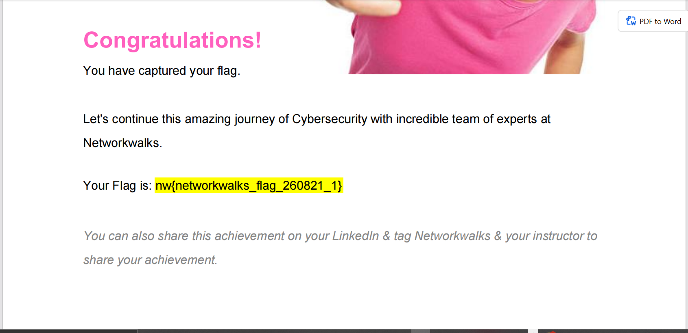
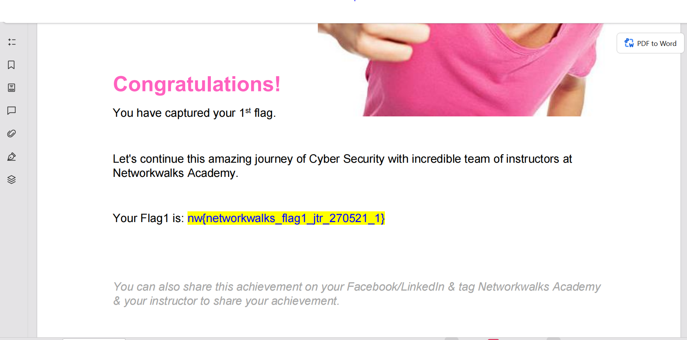
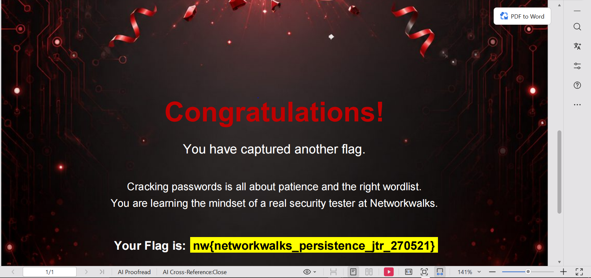
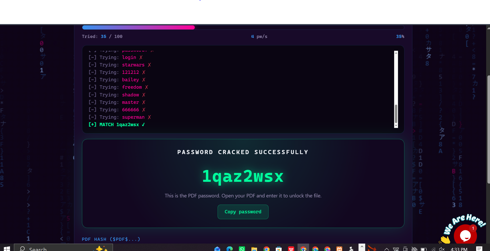
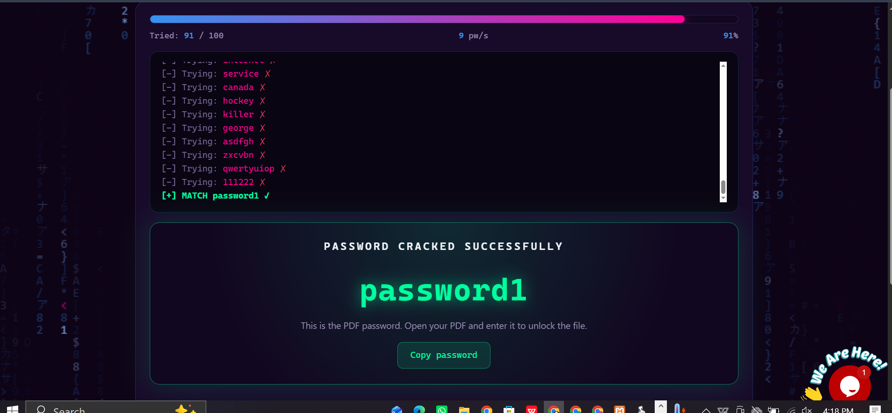
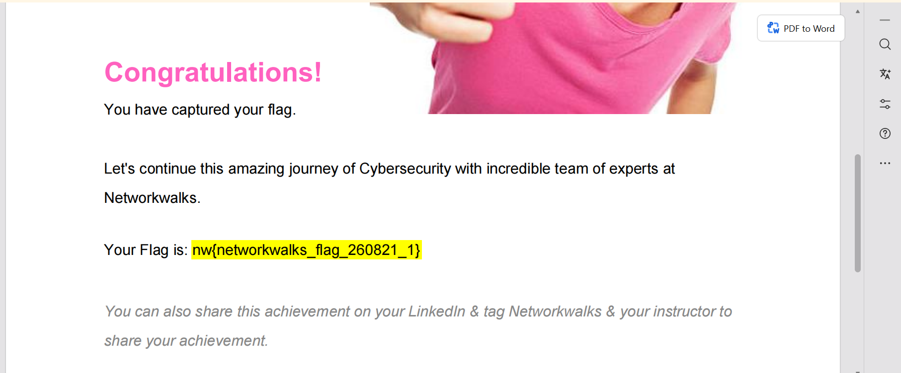

# Weak Password Cracking Lab

## Project Overview

This project demonstrates practical password security testing and password recovery techniques using password-protected PDF documents.

The practical exercise focused on extracting password hashes from locked PDF files and using password-cracking tools to understand how weak passwords can be recovered.

Two approaches were explored:

1. Online Hash Crack with John the Ripper.
2. NetworkWalks Hash Calculator and Password Cracker.

## Project Objectives

- Understand password protection in PDF documents.
- Learn how password hashes are extracted from protected PDF files.
- Practice password recovery using John the Ripper.
- Explore online hash calculation and password-cracking tools.
- Understand dictionary-based password attacks.
- Identify the security risks associated with weak passwords.

## Tools and Websites Used

| Tool | Purpose |
|---|---|
| Online Hash Crack | Used to upload password-protected PDF files and extract their hashes. |
| John the Ripper | Used to perform password recovery using extracted PDF hashes. |
| NetworkWalks Hash Calculator | Used to calculate or obtain password hashes. |
| NetworkWalks Password Cracker | Used to test password candidates against hashes. |

## Practical Methodology

### Method 1: Online Hash Crack and John the Ripper

1. Obtain an authorized password-protected PDF file.
2. Open the Online Hash Crack website.
3. Upload the locked PDF document.
4. Extract the generated PDF password hash.
5. Copy the extracted hash.
6. Use John the Ripper to perform password recovery.
7. Verify the recovered password against the original PDF.

### Method 2: NetworkWalks Online Tools

1. Open the NetworkWalks website.
2. Access the Hash Calculator.
3. Calculate or obtain the required hash.
4. Copy the hash.
5. Open the Password Cracker.
6. Submit the hash for password-cracking tests.
7. Examine the results.

## Screenshots and Evidence

The screenshots directory contains seven screenshots documenting the practical activities.

### Practical Evidence

1. 
2. 
3. 
4. 
5. 
6. 
7. 

## Key Lessons Learned

- Password hashes are important in password security.
- Weak passwords can be vulnerable to dictionary-based attacks.
- Password-cracking tools can be used to evaluate password strength.
- Strong and unpredictable passwords improve document security.
- Password-protected documents should use secure password practices.

## Ethical Considerations

This project was conducted for educational purposes using authorized laboratory files.

Password recovery and password-cracking activities should only be performed on files and systems that you own or have explicit permission to test.

## Author

**Ukwizagira Jean Bosco**

Cybersecurity Student
